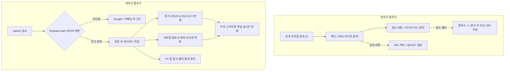
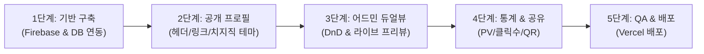

# [PRD] 링크트리 클론 서비스 '마이링크 (MyLink)' 제품 요구사항 정의서

- **문서 버전**: v1.0.0
- **작성 일자**: 2026-11-15
- **서비스명**: 마이링크 (MyLink)
- **대상 사용자**: 1인 크리에이터 / 개발자 본인 전용 멀티링크 및 포트폴리오 프로필
- **기술 스택**: Next.js 16 (App Router), React 19, Tailwind CSS 4, Firebase (Auth, Firestore, Storage)

---

## 1. 프로젝트 개요 (Executive Summary)

### 1.1 배경 및 목적
- SNS(인스타그램, 유튜브, 깃허브, X 등) 프로필에 단 하나의 링크만 게시할 수 있는 제약을 해소하고, 개인의 주요 링크와 포트폴리오를 한눈에 보여주는 **1인 맞춤형 링크-인-바이오(Link-in-bio)** 서비스를 구축합니다.
- 단순 링크 나열을 넘어 **치지직(Chzzk) 스타일의 트렌디한 네온/다크 비주얼**과 미디어 임베드 카드를 제공하여 시각적 차별성을 확보합니다.
- 웹 기반 어드민 대시보드에서 **실시간 모바일 프리뷰**와 함께 드래그 앤 드롭으로 링크를 즉각 관리하고, **방문자 PV 및 링크별 클릭 통계**를 직관적으로 확인합니다.

### 1.2 핵심 가치 (Value Proposition)
1. **나만의 브랜디드 멀티링크**: 치지직 네온 다크 테마를 기본으로 미니멀/라이트 테마까지 자유롭게 선택.
2. **원스톱 관리(WYSIWYG)**: 좌측 편집 패널 + 우측 스마트폰 목업을 통한 직관적인 실시간 관리.
3. **인터랙티브 콘텐츠**: 단순 버튼 링크뿐 아니라 YouTube/치지직 영상 임베드, 프로젝트 배너 카드 지원.
4. **경량 실시간 통계**: 외부 솔루션 없이 Firebase 기반으로 총 PV 및 개별 링크 클릭수 실시간 집계.

---

## 2. 사용자 페르소나 및 저니 (User Journey)

### 2.1 페르소나
- **방문자 (Visitor)**: SNS 프로필 링크나 공유 URL을 타고 모바일/PC로 접속하여 프로필 정보와 링크를 탐색하고 클릭하는 외부 사용자.
- **관리자 (Admin / Owner)**: 사이트 소유자(1인)로, Firebase Auth로 인증된 후 링크 등록/수정/삭제, 테마 변경, 통계 확인을 수행.

### 2.2 사용자 흐름 (Flow Chart)



### 2.3 핵심 사용자 시나리오 (User Scenarios)

#### 시나리오 1: 방문자(외부 팬/채용 담당자)의 프로필 탐색 및 링크 이용
- **상황**: 인스타그램 바이오 또는 치지직 방송 소개글의 링크(`mylink.io`)를 클릭하여 스마트폰으로 접속함.
- **주요 여정**:
  1. 페이지 진입 즉시 1초 이내에 치지직 네온 다크 테마의 감각적인 프로필 헤더(아바타, 상태메시지, PRO 뱃지)를 확인한다.
  2. 상단 소셜 아이콘 바에서 `GitHub` 아이콘을 터치하여 최근 커밋 활동을 확인한다.
  3. 상단 고정(Pin)된 '신규 프로젝트 데모 영상' 카드를 보고 인라인 플레이어로 데모를 시청한다.
  4. '포트폴리오 다운로드' 버튼 링크를 클릭하여 상세 문서를 열람한다 (백그라운드에서 해당 링크 클릭수 +1 집계).
  5. 상단 공유 버튼을 눌러 모바일 네이티브 공유 시트(Web Share)를 통해 지인에게 링크를 전달한다.
- **기대 결과**: 원하는 정보(포트폴리오, SNS, 시연 영상)를 이탈 없이 10초 이내에 직관적으로 파악하고 전환(클릭/시청) 달성.

#### 시나리오 2: 관리자(소유자)의 신규 링크 등록 및 드래그 앤 드롭(DnD) 순서 변경
- **상황**: 새로운 블로그 글을 발행하여 마이링크 최상단에 홍보 링크를 즉시 배치하고자 함.
- **주요 여정**:
  1. 데스크톱 브라우저에서 `/admin`으로 접속하여 Google 계정으로 1초 만에 로그인한다.
  2. 좌측 편집 패널에서 `[+ 새 링크 추가]` 버튼을 클릭하고 제목("신규 기술 블로그 글"), URL, 설명을 입력한다.
  3. '상단 고정(Pin)' 스위치를 켜면 우측 스마트폰 목업 화면 최상단에 네온 테두리 강조 배지와 함께 실시간 반영되는 것을 확인한다.
  4. 이전 공지 링크는 드래그 핸들(:::)을 마우스로 잡아 아래로 끌어내려 순서를 재배치한다.
  5. 일시 중단할 링크는 '노출 활성(ON/OFF)' 스위치를 꺼서 스마트폰 목업에서 즉시 숨겨지는 것을 확인한다.
- **기대 결과**: 별도 빌드나 배포 과정 없이 1분 안에 웹 UI에서 실시간으로 링크를 재정렬하고 공개 상태로 전환.

#### 시나리오 3: 테마 프리셋 전환 및 브랜딩 커스터마이징
- **상황**: 계절 리뉴얼이나 포트폴리오 성격에 맞춰 '치지직 네온 다크'에서 '미니멀 모던'이나 '클린 라이트'로 분위기를 바꾸고 싶음.
- **주요 여정**:
  1. 어드민 대시보드의 `테마 설정` 탭을 선택한다.
  2. 테마 프리셋 카드(치지직 네온 다크, 미니멀 모던, 클린 라이트) 중 '미니멀 모던'을 클릭한다.
  3. 우측 스마트폰 목업의 배경색, 버튼 둥글기, 폰트 컬러가 다크 모노톤으로 즉시 전환되는 모습을 확인한다.
  4. `[테마 적용]`을 누르면 Firestore에 저장되어 실제 공개 페이지 방문자에게도 즉각 새로운 테마가 노출된다.
- **기대 결과**: 코드 수정 없이 원클릭으로 서비스 전반의 시각적 브랜드 톤앤매너를 손쉽게 변경.

#### 시나리오 4: 링크 성과 분석 및 통계 모니터링
- **상황**: SNS 채널에 링크를 공유한 뒤 어떤 링크가 가장 많은 클릭과 관심을 유도했는지 확인하고자 함.
- **주요 여정**:
  1. 어드민 대시보드의 `통계 요약` 탭으로 이동한다.
  2. 상단 요약 지표에서 누적 프로필 방문수(PV: 1,280회), 총 링크 클릭수(710회), 평균 CTR(55.4%)을 확인한다.
  3. 링크별 클릭 순위에서 '프로젝트 시연 영상'(클릭수 310회)이 가장 높은 성과를 낸 것을 확인한다.
  4. 클릭수가 저조한 하단 링크는 제목을 더 직관적인 카피로 수정하거나 순서를 상단으로 이동시키는 의사결정을 내린다.
- **기대 결과**: 실시간 데이터 기반으로 링크 배치 및 콘텐츠 노출 전략을 지속 최적화.

#### 시나리오 5: 오프라인 네트워킹 및 모바일 QR 코드 공유
- **상황**: 개발자 컨퍼런스나 밋업 행사에서 종이 명함 대신 스마트폰으로 프로필 링크를 즉석 공유하고자 함.
- **주요 여정**:
  1. 스마트폰으로 본인의 마이링크 메인 페이지에 접속한 후 상단 [공유] 아이콘을 탭한다.
  2. 공유 모달에서 `QR 코드` 탭을 선택하여 화면 가득 선명한 QR 코드를 띄운다.
  3. 상대방이 카메라 앱으로 QR 코드를 스캔하면 상대방 브라우저에 마이링크가 즉시 열린다.
- **기대 결과**: URL 타이핑이나 검색 번거로움 없이 3초 만에 오프라인에서 온라인 프로필로 연결.

---

## 3. 기능 요구사항 명세 (Functional Requirements)

### F-01. 공개 프로필 페이지 (`/`)

| ID | 기능명 | 상세 명세 | 우선순위 |
| :--- | :--- | :--- | :---: |
| **F-01-1** | **프로필 헤더** | • 아바타 프로필 사진 (원형, 호버 효과)<br>• 이름/닉네임, 한 줄 상태 메시지, 전문 태그/배지<br>• 인증 마크(Verified Badge) 옵션 | P0 |
| **F-01-2** | **소셜 아이콘 바** | • GitHub, LinkedIn, YouTube, Instagram, X, 치지직, 이메일 등 주요 SNS 바로가기 아이콘 그리드 | P0 |
| **F-01-3** | **스마트 링크 목록** | • 링크 제목, 타깃 URL, 보조 설명(Description)<br>• **상단 고정 (Pin)**: 최상단 강조 배지와 함께 고정 노출<br>• 링크 클릭 시 백그라운드로 클릭 카운트 증가 후 새 탭 열림 | P0 |
| **F-01-4** | **미디어 / 프로젝트 카드** | • YouTube 및 치지직 영상 iframe 반응형 임베드<br>• 프로젝트 썸네일 이미지 + 타이틀 + 요약 카드 링크 | P1 |
| **F-01-5** | **공유 (Share) 툴킷** | • **URL 클립보드 복사** (원클릭 토스트 피드백)<br>• **Web Share API**: 모바일 환경에서 네이티브 공유 시트 호출<br>• **QR 코드 모달**: 오프라인 또는 PC→모바일 스캔용 QR 코드 즉석 렌더링 | P1 |
| **F-01-6** | **방문자 집계 (PV)** | • 페이지 로드 시 Firestore의 총 조회수(PV) 원자적(Atomic) 1 증가 | P0 |

---

### F-02. 관리자 인증 및 보안 (`/admin/login`, `/admin`)

| ID | 기능명 | 상세 명세 | 우선순위 |
| :--- | :--- | :--- | :---: |
| **F-02-1** | **관리자 로그인** | • Firebase Authentication (Google OAuth 로그인 또는 지정 이메일/비밀번호)<br>• 환경변수(`NEXT_PUBLIC_ADMIN_EMAIL`)에 등록된 단일 관리자만 인가 | P0 |
| **F-02-2** | **접근 제어 (Route Guard)** | • `/admin` 하위 경로 진입 시 Auth State 검증<br>• 비인가자 접근 시 로그인 화면으로 리다이렉트 및 접근 차단 | P0 |
| **F-02-3** | **Firestore 보안 규칙** | • 일반 방문자: 프로필, 활성화된 링크, 테마 읽기(`read`) 및 통계 증가(`increment`)만 허용<br>• 관리자 UID: 전체 쓰기/수정/삭제 권한 부여 | P0 |

---

### F-03. 어드민 대시보드 & 실시간 편집기 (`/admin`)

> [!IMPORTANT]
> **Linktree 시그니처 듀얼 뷰(Dual View)**: 데스크톱 화면에서 좌측은 탭 기반 편집 컨트롤, 우측은 실제 스마트폰 프레임(375px) 목업을 배치하여 모든 변경사항이 실시간으로 동기화됩니다.

```
+-----------------------------------------------------------------------------------+
|  [MyLink Admin]  프로필 관리 | 링크 목록 | 테마 설정 | 통계 요약         (로그아웃) |
+------------------------------------------------------+----------------------------+
|  [좌측: 편집 컨트롤 패널]                             | [우측: 모바일 라이브 뷰]     |
|                                                      |  +----------------------+  |
|  [+] 새 링크 추가하기                                  |  |     [스마트폰 목업]     |  |
|  --------------------------------------------------  |  |                      |  |
|  [::: Drag]  GitHub 바로가기       [Pin] [ON/OFF] [x]|  |      (●) 아바타      |  |
|              https://github.com/..   클릭수: 142회    |  |       배찬혁        |  |
|                                                      |  |    개발자 포트폴리오  |  |
|  [::: Drag]  치지직 라이브 채널    [Pin] [ON/OFF] [x]|  |   [ 깃허브 ] [ 유튜브 ] |  |
|              https://chzzk.naver..   클릭수: 89회     |  |                      |  |
|                                                      |  |  +----------------+  |  |
|  [::: Drag]  [영상] 프로젝트 시연 영상                |  |  |  GitHub 바로가기  |  |  |
|              YouTube Embed URL                       |  |  +----------------+  |  |
|                                                      |  +----------------------+  |
+------------------------------------------------------+----------------------------+
```

| ID | 기능명 | 상세 명세 | 우선순위 |
| :--- | :--- | :--- | :---: |
| **F-03-1** | **링크 CRUD & 유효성** | • 링크 제목, URL(자동 http/https 보정), 설명, 아이콘 타입 입력/수정/삭제 | P0 |
| **F-03-2** | **드래그 앤 드롭 (DnD)** | • `@hello-pangea/dnd` 또는 `@dnd-kit`을 활용한 부드러운 순서 재배치<br>• 드롭 완료 시 `order` 인덱스 자동 갱신 및 Firestore 동기화 | P0 |
| **F-03-3** | **노출 상태 토글 (ON/OFF)** | • 삭제하지 않고 임시로 비공개할 수 있는 스위치 토글 | P0 |
| **F-03-4** | **상단 고정 (Pin)** | • 특정 중요 링크(예: 채용 공고, 신규 릴리즈 영상)를 상단 강조 카드로 고정 | P1 |
| **F-03-5** | **프로필/소셜 링크 편집** | • 아바타 이미지 업로드(Firebase Storage 연동)<br>• 이름, 상태 메시지, 뱃지 문구 수정<br>• SNS 계정별 ID/URL 설정 | P0 |
| **F-03-6** | **실시간 프리뷰 동기화** | • 상태 변경 시 우측 모바일 뷰에 지연 없이 즉각 반응 | P0 |

---

### F-04. 테마 및 디자인 시스템

| ID | 기능명 | 상세 명세 | 우선순위 |
| :--- | :--- | :--- | :---: |
| **F-04-1** | **치지직 네온 다크 (기본)** | • 배경: `#141517` / `#0E0F10`<br>• 브랜드 포인트: Neon Green (`#00FFA3`), Strong Green (`#1BB373`)<br>• 버튼: 표면 다크 서피스 (`#202224`) + 네온 그린 보더/글로우 호버 | P0 |
| **F-04-2** | **미니멀 모던 테마** | • 딥 차콜/블랙 배경 (`#09090b`) + 세련된 화이트/그레이 모노톤 버튼 | P1 |
| **F-04-3** | **클린 라이트 테마** | • 부드러운 오프화이트 배경 (`#F9F9F9`) + 선명한 텍스트 및 라운드 그림자 버튼 | P1 |
| **F-04-4** | **원클릭 테마 전환** | • 관리자 패널에서 테마 카드 클릭 시 `currentTheme` 설정 저장 및 전역 반영 | P0 |

---

### F-05. 통계 및 분석 (Analytics Engine)

| ID | 기능명 | 상세 명세 | 우선순위 |
| :--- | :--- | :--- | :---: |
| **F-05-1** | **총 프로필 방문수 (PV)** | • 누적 전체 페이지 로드 횟수 집계 및 어드민 상단 카드에 표기 | P0 |
| **F-05-2** | **링크별 누적 클릭수** | • 각 링크 아이템별 클릭 발생 시 `clickCount: increment(1)` 업데이트<br>• 어드민 링크 목록에 실시간 클릭 횟수 배지 표시 | P0 |
| **F-05-3** | **CTR(클릭률) 요약** | • 총 PV 대비 총 링크 클릭 수의 비율 (%) 계산 요약 카드 제공 | P1 |

---

### F-06. SEO 및 메타데이터 최적화

| ID | 기능명 | 상세 명세 | 우선순위 |
| :--- | :--- | :--- | :---: |
| **F-06-1** | **Open Graph (OG) 태그** | • 카카오톡, 슬랙, 인스타그램 등 링크 첨부 시 대표 이미지, 타이틀, 설명 최적화 | P0 |
| **F-06-2** | **Twitter Card 메타데이터** | • `summary_large_image` 포맷 지원 | P1 |
| **F-06-3** | **파비콘 및 PWA 매니페스트** | • 모바일 홈 화면 추가(PWA 아이콘) 지원 | P2 |

---

## 4. 데이터베이스 스키마 설계 (Firestore Collections)

```
[Firestore Root]
├── settings/
│   └── profile/
│       ├── name: string ("배찬혁")
│       ├── bio: string ("프론트엔드 개발자 & 크리에이터")
│       ├── avatarUrl: string
│       ├── badgeText: string ("PRO")
│       ├── theme: "chzzk" | "minimal" | "light"
│       ├── socials: {
│       │     github?: string,
│       │     linkedin?: string,
│       │     youtube?: string,
│       │     instagram?: string,
│       │     chzzk?: string,
│       │     email?: string
│       │   }
│       └── updatedAt: Timestamp
│
├── links/ {linkId}/
│   ├── title: string ("개인 포트폴리오 웹사이트")
│   ├── url: string ("https://...")
│   ├── description: string ("진행했던 프로젝트 모음")
│   ├── type: "link" | "media" | "banner"
│   ├── mediaEmbedUrl?: string (YouTube embed url 등)
│   ├── isPinned: boolean (false)
│   ├── isEnabled: boolean (true)
│   ├── order: number (0, 1, 2...)
│   ├── clickCount: number (0)
│   └── createdAt: Timestamp
│
└── stats/
    └── summary/
        ├── totalPageViews: number (FieldValue.increment)
        ├── totalClicks: number (FieldValue.increment)
        └── lastVisitedAt: Timestamp
```

---

## 5. UI/UX 화면 설계 및 컴포넌트 구조

```
src/
├── app/
│   ├── layout.tsx             # 전역 폰트(Pretendard), 메타데이터 설정
│   ├── globals.css            # Tailwind 4 설정 및 치지직 테마 CSS 변수
│   ├── page.tsx               # [방문자] 메인 공개 프로필 페이지
│   ├── admin/
│   │   ├── layout.tsx         # 어드민 가드 및 네비게이션 헤더
│   │   ├── page.tsx           # [관리자] 듀얼 뷰 대시보드 (편집기 + 프리뷰)
│   │   └── login/
│   │       └── page.tsx       # [관리자] Firebase Auth 로그인 페이지
├── components/
│   ├── public/
│   │   ├── ProfileHeader.tsx  # 아바타, 닉네임, 소개, 소셜 아이콘 바
│   │   ├── LinkButton.tsx     # 개별 링크 버튼 컴포넌트 (Pin 배지, 클릭 트래킹)
│   │   ├── MediaCard.tsx      # YouTube / 치지직 영상 임베드 카드
│   │   ├── ShareModal.tsx     # Web Share API, 클립보드 복사, QR코드 팝업
│   │   └── ThemeWrapper.tsx   # 선택된 테마별 CSS 토큰 주입 래퍼
│   ├── admin/
│   │   ├── LinkEditorList.tsx # 드래그 앤 드롭 링크 관리 리스트
│   │   ├── LinkEditModal.tsx  # 신규 링크 추가/수정 모달 또는 인라인 폼
│   │   ├── ProfileEditor.tsx  # 프로필 기본 정보 및 이미지 업로더
│   │   ├── ThemeSelector.tsx  # 프리셋 테마 선택 패널
│   │   ├── StatsOverview.tsx  # PV, 클릭수, CTR 대시보드 위젯
│   │   └── PhonePreview.tsx   # 우측 실시간 모바일 폰 목업
│   └── ui/
│       ├── Button.tsx, Input.tsx, Switch.tsx, Toast.tsx
└── lib/
    ├── firebase.ts            # Firebase App, Auth, Firestore, Storage 초기화
    ├── links.ts               # 링크 CRUD 및 Firestore 트랜잭션 함수
    ├── profile.ts             # 프로필 정보 조회 및 업데이트
    └── stats.ts               # PV 및 클릭수 increment 트래커
```

---

## 6. 비기능적 요구사항 (Non-Functional Requirements)

1. **성능 및 Core Web Vitals**:
   - 모바일 LCP(Largest Contentful Paint) < 1.2초 목표
   - Next/Image 컴포넌트 활용 아바타 및 배너 WebP/AVIF 최적화
2. **모바일 퍼스트 반응형 디자인**:
   - 공개 프로필은 최대 가로폭 `max-w-md (448px)` 중심의 완벽한 모바일 전용 뷰포트 제공
   - 데스크톱 접속 시에도 세로형 카드 레이아웃으로 미려하게 중앙 정렬
3. **오프라인/에러 내구성**:
   - Firebase 연결 실패 시 로컬 캐시(IndexedDB) 또는 기본 Fallback 프로필 렌더링
4. **접근성 (A11y)**:
   - 모든 링크 버튼 및 아이콘에 명확한 `aria-label` 및 키보드 탭 네비게이션 지원

---

## 7. 개발 마일스톤 및 로드맵



| 단계 | 주요 작업 내용 | 산출물 |
| :--- | :--- | :--- |
| **Phase 1** | Firebase Config 설정, Firestore 스키마 생성, Auth 관리자 계정 연동 | `firebase.ts`, DB 초기 데이터 |
| **Phase 2** | 메인 프로필 페이지(`/`), 치지직 네온 다크 디자인 적용, 반응형 링크 버튼 | `page.tsx`, `ProfileHeader`, `LinkButton` |
| **Phase 3** | 어드민 로그인 및 라우트 가드, 좌측 DnD 편집기 + 우측 모바일 라이브 프리뷰 | `/admin/page.tsx`, `PhonePreview` |
| **Phase 4** | Firestore 원자적 클릭수/PV 증가 기능, QR코드/공유 모달, 테마 프리셋 전환 | `stats.ts`, `ShareModal`, `ThemeSelector` |
| **Phase 5** | OG 태그 메타데이터 최적화, 빌드 검증 및 Vercel 배포 | 프로덕션 릴리즈 |
